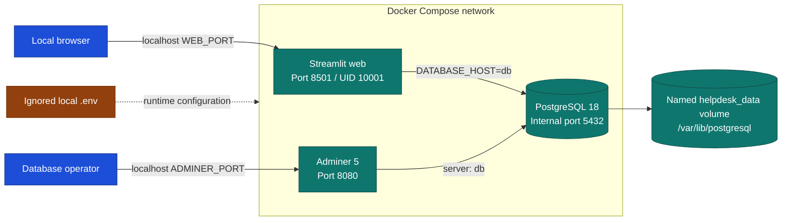
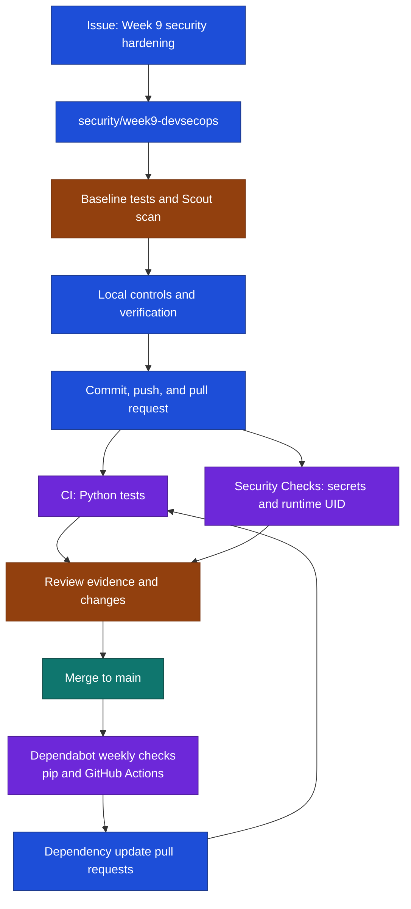
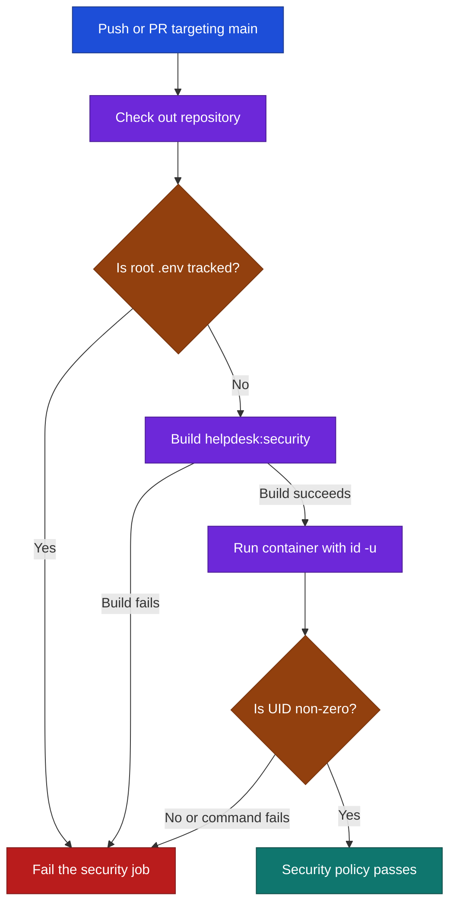

# Help Desk DevSecOps | SDI 4213 Week 9

[](https://github.com/CloudWizardBoricua/sdi4213-week9-devsecops/actions/workflows/ci.yml)
[](https://github.com/CloudWizardBoricua/sdi4213-week9-devsecops/actions/workflows/security.yml)

A Streamlit service-request tracker with PostgreSQL and Adminer, extended with local-secret protection, weekly dependency updates, Docker Scout analysis, a dedicated non-root container user, and automated GitHub Actions policies. Week 9 secures the existing delivery workflow while preserving application behavior.

## Submission

- [Assignment issue #1](https://github.com/CloudWizardBoricua/sdi4213-week9-devsecops/issues/1)
- [Merged security PR #3](https://github.com/CloudWizardBoricua/sdi4213-week9-devsecops/pull/3)
- [Evidence PDF: ten milestones and four reflections](output/pdf/Week9_DevSecOps_Evidence.pdf)
- [Evidence index and provenance](docs/evidence/README.md) · [Raw command records](docs/evidence/logs/)
- [Original assignment](docs/Week9_Individual_Exercise.docx)

## Architecture

Diagram legend: **blue = client/development**, **teal = application/data**, **purple = automation**, **amber = review/decision**, **red = rejection**. Text labels preserve meaning without relying on color.



The database has no published host port. Web and Adminer bind to localhost. Compose waits for PostgreSQL's health check before starting dependent services. The PostgreSQL 18 volume mount is `/var/lib/postgresql`, which retains its version-specific data directory correctly.

## Prerequisites and setup

Install Git and Docker Desktop with Linux containers, Compose, and Docker Scout. Sign in to Docker Desktop or run `docker login` if Scout requests authentication. Native execution uses Python **3.13**; the container commands below do not require that version on the host.

Check `docker version`, `docker compose version`, and `docker scout version` before starting.

Windows PowerShell:

```powershell
git clone https://github.com/CloudWizardBoricua/sdi4213-week9-devsecops.git
Set-Location sdi4213-week9-devsecops
Copy-Item .env.example .env
```

macOS/Linux:

```bash
git clone https://github.com/CloudWizardBoricua/sdi4213-week9-devsecops.git
cd sdi4213-week9-devsecops
cp .env.example .env
```

Edit `.env` locally and replace the sample password with a unique development password. A randomly generated hexadecimal value avoids URL-reserved characters in the starter's connection string. Never print `.env` into logs or screenshots.

```bash
git check-ignore .env
docker compose up -d --build
docker compose ps
```

Defaults: **http://localhost:8501** for the web app and **http://localhost:8080** for Adminer. In Adminer select PostgreSQL, use server `db`, and enter the credentials/database from your local configuration.

**This workstation:** the existing Week 7 stack uses 8501 and Windows reserves 8080. The ignored local configuration therefore sets `WEB_PORT=8502` and `ADMINER_PORT=18081`: **http://localhost:8502** and **http://localhost:18081**. Container ports remain 8501 and 8080; the Week 7 stack is unaffected.

### Environment variables

| Variable | Default/example | Purpose |
| --- | --- | --- |
| `POSTGRES_USER` | `student` | Application database role |
| `POSTGRES_PASSWORD` | Placeholder only | Replace with a local development password |
| `POSTGRES_DB` | `helpdesk` | Database initialized by PostgreSQL |
| `WEB_PORT` | `8501` | Optional localhost port mapped to container 8501 |
| `ADMINER_PORT` | `8080` | Optional localhost port mapped to container 8080 |
| `DATABASE_HOST` | `db` | Application database hostname |
| `DATABASE_PORT` | `5432` | PostgreSQL port |
| `DATABASE_URL` | Unset | Optional complete URL for native execution |

Compose explicitly supplies `DATABASE_HOST=db` and `DATABASE_PORT=5432`; editing those two values in `.env` alone does not change the Compose definitions. In native execution, exported `DATABASE_URL` takes precedence, then `DATABASE_HOST`; without either, the app uses SQLite. Native execution does not automatically load `.env`.

### Using and stopping the application

Enter a title and description, select category/priority, and submit. Requests start as **Open**; select one and change it to **In Progress** or **Closed**. The counters and table reflect stored data. The named PostgreSQL volume survives container recreation.

`docker compose down` stops this stack and retains its named volume. Add `--volumes` only when you intend to erase the local database. This repository provides a local learning environment, not a publicly hosted application.

## Tests and runtime verification

```bash
docker build -t helpdesk:week9-after -t helpdesk:security .
docker run --rm --entrypoint id helpdesk:week9-after -u
```

Expected UID: **10001**. The Dockerfile creates `appuser`, assigns the required ownership, and sets `USER appuser` before `CMD`. The writable working directory also supports the starter's optional SQLite mode.

Run tests inside Python 3.13 without mounting secrets (PowerShell):

```powershell
docker run --rm --mount "type=bind,source=$($PWD.Path)\tests,target=/app/tests,readonly" --entrypoint python helpdesk:week9-after -m pytest -v -p no:cacheprovider tests
```

macOS/Linux:

```bash
docker run --rm --mount "type=bind,source=$(pwd)/tests,target=/app/tests,readonly" --entrypoint python helpdesk:week9-after -m pytest -v -p no:cacheprovider tests
```

The two original tests cover request creation/listing and status updates using in-memory SQLite. PostgreSQL, browser interaction, and persistence are checked separately in the integration evidence.

For native execution, create a Python 3.13 virtual environment, install `requirements.txt`, and run `python -m pytest -v`. Start the app with `python -m streamlit run app/main.py`. On Windows the environment executable is `.venv\Scripts\python.exe`; on macOS/Linux it is `.venv/bin/python`.

## Delivery workflow



The original [CI workflow](.github/workflows/ci.yml) and new [security workflow](.github/workflows/security.yml) run on pushes to `main` and PRs targeting `main`. Both have read-only repository permissions; security checks have a 15-minute timeout. [Dependabot](.github/dependabot.yml) checks pip and GitHub Actions weekly after its configuration reaches `main`.

### Enforced security policy



`.gitignore` and `.dockerignore` exclude `.env` and `.env.*`, while allowing `.env.example`. CI checks Git's index, so even a forcibly tracked root `.env` fails. This targeted policy is not a general secret scanner or CVE remediation system. A failed job reports a policy violation; merge blocking also depends on branch-protection settings.

The optional `scripts/verify_security_policy.py` reads the actual workflow shell steps and verifies four cases: untracked `.env` accepted, tracked **dummy** `.env` rejected, baseline root image rejected, and hardened image accepted. It requires PyYAML (`python -m pip install PyYAML` in a development environment), Git Bash on Windows, and both image tags. Fixtures stay under ignored `tmp/` and are never pushed.

## Docker Scout analysis

The baseline was scanned **October 25, 2026**, before Dockerfile hardening, using Docker Scout **1.25.0**. Functional tests passed while Scout identified known vulnerable packages.

| Measurement | Baseline result |
| --- | --- |
| Image / digest prefix | `helpdesk:week9-before` / `b6f3ce69d928` |
| Base / runtime | `python:3.13-slim` / Python 3.13.17 |
| Platform / indexed packages | `linux/amd64` / 189 |
| Vulnerable packages | 19 |
| Critical / High / Medium / Low | **5 / 41 / 23 / 28** |
| Total findings | **97** |

Sources: [full CVE output](docs/evidence/logs/baseline-cves.txt), [command/time metadata](docs/evidence/logs/baseline-cves.json), [image identity](docs/evidence/logs/baseline-image.txt).

**Interpretation:** Pillow 11.3.0 accounted for all five critical findings and 35 high findings. Other findings involved Python tooling and operating-system packages. A package/advisory match does not establish exploitability through every application path. Pytest checks requested behavior; Scout compares the software inventory with security advisories.

**Recommendations:** Scout identified `3.13-slim` as up to date. It listed newer Python minor versions with the same base severity totals and an Alpine alternative with fewer findings but a different OS/runtime combination. Python 3.13 is retained for course compatibility; dependency and base-image upgrades belong in tested follow-up PRs. See [complete recommendations](docs/evidence/logs/baseline-recommendations.txt).

**SBOM:** the [inventory](docs/evidence/logs/baseline-sbom.txt) lists package names, versions, and ecosystems, including Debian and Python. Scout uses this inventory to match advisories. A current base tag does not imply a vulnerability-free application image.

**Non-root is a separate control:** UID 10001 reduces privileges available after a compromise. It does not patch packages, remove CVEs, or guarantee isolation. This assignment records the baseline findings; it does not claim zero vulnerabilities.

```bash
docker scout cves helpdesk:week9-before
docker scout recommendations helpdesk:week9-before
docker scout sbom --format list helpdesk:week9-before
```

To rebuild a fresh baseline, check out starter commit `86da7cd` in a separate directory and build that Dockerfile with the before tag. The original local image is preserved. Mutable image tags, transitive dependencies, and advisory databases mean later scans can differ from this dated evidence. Do not tag the hardened Dockerfile as the baseline.

## Evidence and reproducibility

The PDF covers milestones 1–10: baseline; ignored `.env`; GitHub Dependabot configuration; CVE summary; recommendations/SBOM; hardened Dockerfile; non-zero UID; GitHub security workflow; passing Actions; final PR and four reflections.

`scripts/record_evidence.py` captures actual stdout/stderr, arguments, UTC timestamps, and exit codes. The evidence index identifies how screenshots were captured. Raw logs preserve full output beyond screenshot excerpts. Scout emitted a temporary-archive cleanup warning but completed the CVE report with exit code 0; the warning is retained.

The report contains one overview page, ten screenshot pages, and a continuation page with the four Milestone 10 reflections. To regenerate it, install ReportLab in a development environment and run `python scripts/build_evidence_pdf.py`; its source text comes from the evidence index. Both course workflows and both Dependabot ecosystem checks passed after the security PR reached `main`.

## Troubleshooting

| Symptom | Action |
| --- | --- |
| Docker engine unavailable | Start Docker Desktop; confirm `docker version` shows a server. |
| Port allocated or forbidden | Change `WEB_PORT`/`ADMINER_PORT` locally, then run `docker compose up -d`. |
| PostgreSQL 18 storage error | Use `/var/lib/postgresql`; do not delete existing data to conceal a configuration issue. |
| Database login fails after editing `.env` | A pre-existing volume retains its initialized credentials; editing environment variables does not change the stored password. |
| Host Python dependencies fail | Use the Python 3.13 container commands or a Python 3.13 virtual environment. |
| Scout requests authentication | Use Docker's normal sign-in flow; exclude credentials from evidence. |
| CI reports tracked `.env` | Untrack it, retain it locally, and rotate any exposed real credentials. |

## Repository guide and references

`app/` and `tests/` retain the starter application and tests. `.github/` holds automation. `docs/evidence/` contains records and screenshots. `output/pdf/` contains the submission PDF. `scripts/` contains evidence utilities; `student-resources/` retains starter reference files.

- [PostgreSQL official image and version 18 volume layout](https://hub.docker.com/_/postgres)
- [Docker Scout CVE command](https://docs.docker.com/reference/cli/docker/scout/cves/)
- [Docker Scout SBOM command](https://docs.docker.com/reference/cli/docker/scout/sbom/)
- [Dependabot configuration on the default branch](https://docs.github.com/en/code-security/concepts/supply-chain-security/about-the-dependabot-yml-file)
